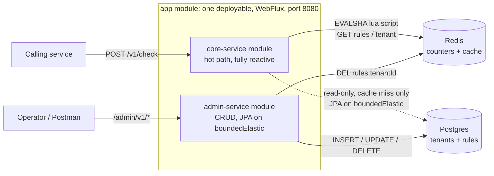
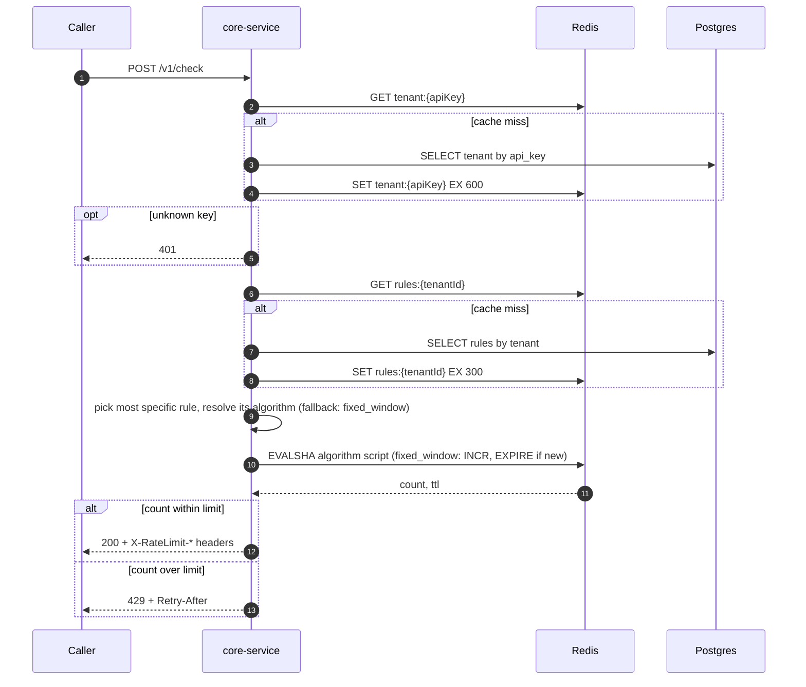
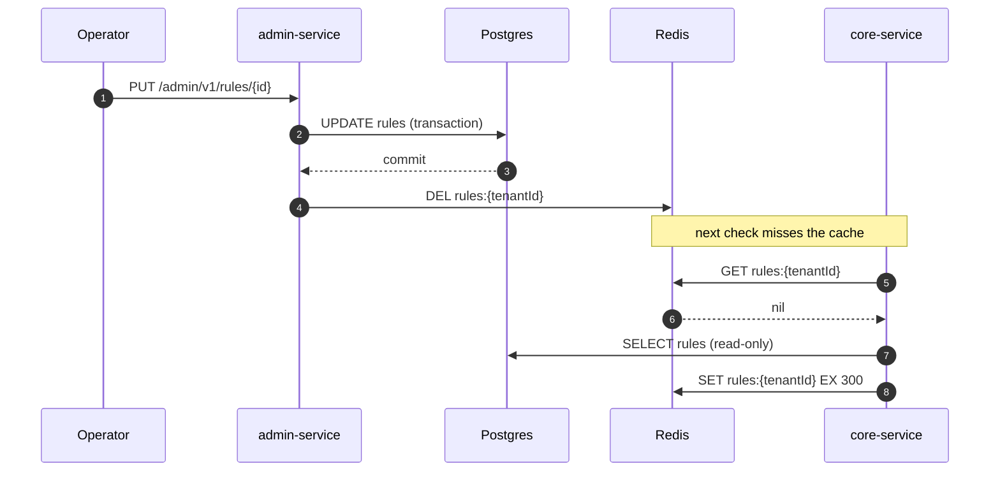
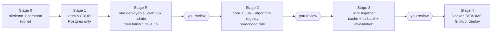

# Rate Limiter as a Service: v1 build plan

A standalone rate-limit service that other services call over HTTP. It ships as **one deployable** (the `app` module) on a single WebFlux stack. Inside it, two library modules keep the concerns apart: `core-service` answers allow or deny in under 5ms, and `admin-service` manages tenants and rules (blocking JPA, kept off the event loop). Fixed window and REST only for now, but the algorithm layer is built so more algorithms can be added without editing existing code. Nothing from the deferred list (token bucket, sliding window, Kafka, metrics, gRPC, k6, AI, UI) is in scope.

Stage 0 (parent POM, `common` module, both module skeletons, Maven installed) is done. Work proceeds one step at a time; tell Claude "Implement step 1.3 from PLAN.md". Claude ticks the box here when a step is finished and stops for review at the end of each stage.

## Flow diagrams

### Architecture



### One check request



### Rule edit and cache invalidation



### Build order



## Decisions (defaults, change any before the stage starts)

1. **limit column:** `LIMIT` is a reserved SQL word, so the column is `max_requests`. The DTO field stays `limit`.
2. **API key:** `rl_` plus 32 random bytes, base64url, stored as plain text in v1 because the spec looks tenants up by key.
3. **Admin auth:** none in v1, as the spec lists none. Admin and check now share one port, so the whole deployment is assumed to be internal; the README must say so.
4. **Window start:** `floor(now / windowSeconds) * windowSeconds`, computed in core-service.
5. **Counter key:** `rl:{algorithm}:...` with the algorithm name first, so two algorithms never share a key or a Redis type. Each algorithm builds the rest of its own key. Fixed window uses `rl:fixed_window:{tenantId}:{method}:{endpoint}:{windowStart}`, with the matched rule's endpoint and method, not the raw request endpoint, so a wildcard rule shares one counter. The spec says `{endpoint}`; this is a small deviation.
6. **No matching rule:** allow the request.
7. **Redis down:** fail open (allow) and log a warning.
8. **core-service Postgres access:** read-only JPA entities, called on a bounded-elastic thread so the event loop never blocks. core-service has its own `@Immutable` entity classes (not admin's), mapped to the same tables.
9. **One deployable, multi-module.** A new `app` module holds the only `@SpringBootApplication`, the single `application.yaml` (port 8080) and the exception handler. `admin-service` and `core-service` become plain library jars (no Boot repackaging). Only `app` depends on both; the two modules never depend on each other and share only `common`, Postgres and Redis. Reason: keep the project simple for now. A two-service split (separate scaling, separate exposure of admin) is a valid later step, and the module boundary keeps it cheap.
10. **Whole app is WebFlux, pattern "C" for blocking code.** No R2DBC. JPA and JDBC stay, wrapped as `Mono.fromCallable(...).subscribeOn(Schedulers.boundedElastic())`. The blocking service method runs whole inside the callable, so `@Transactional` stays on one thread. Admin controllers return `Mono`; admin services and repositories stay blocking. Flyway runs on JDBC at startup (it has no R2DBC support and runs once before traffic). The DB is not on the hot path (Redis first, Postgres only on a cache miss), so a blocking driver is enough. If R2DBC is ever wanted, it only touches the repositories.
11. **Extensible algorithms.** Strategy pattern plus a registry:
    - `RateLimitAlgorithm` declares its `AlgorithmType type()`. `AlgorithmRegistry` is built from every `RateLimitAlgorithm` bean Spring finds, and fails at startup if two claim the same type.
      - `AlgorithmType` is an enum in `common`, shared by both modules, JSON as lowercase (`fixed_window`) via `@JsonValue`/`@JsonCreator`. It is the contract; a new algorithm needs three additions and no edit to existing logic: one enum line, one `XxxLimiter` class, one `.lua` file.
      - Stored in Postgres as `VARCHAR` with `@Enumerated(EnumType.STRING)`, never ordinal. No `CHECK` constraint, so a new algorithm needs no migration; the enum is validated in the app.
      - `RuleDto.algorithm` null means `fixed_window`. Admin rejects an unknown value with 400.
      - A core test asserts every `AlgorithmType` value has an implementation, so the build fails if one is forgotten.
12. **Unknown algorithm at runtime: fall back, do not fail open and do not 500.** If a rule's algorithm has no implementation (should not happen with decision 11), the registry runs `fixed_window` with the rule's own limit and window and logs an ERROR naming the rule and the value. The counter key uses the algorithm actually run, so keys never collide. Rules are parsed one by one when read from cache or Postgres, so one bad rule cannot break the others for that tenant.
13. **Rule parameters stay limit + window for now.** Fixed window, sliding window and token bucket (capacity = limit, refill = limit / window) all fit. Algorithm-specific columns are added only when a real second algorithm needs them (see Parked for future discussion).

## Stage 1: admin-service CRUD

Tenants and rules can be created, read, updated and deleted through REST, backed by Postgres and Flyway. No Redis yet.

Note: steps 1.9 to 1.11 were built on Spring MVC and are converted to WebFlux in Stage R. Steps 1.13 to 1.15 are scheduled after Stage R so the tests target the final shape (WebTestClient, one app).

- [x] **1.1 Postgres in Docker Compose.** infra/docker-compose.yml with the postgres:16-bookworm image (the default Debian 13 image rejects the legacy timezone names some JVMs send, e.g. Asia/Calcutta): db ratelimiter, user and password ratelimiter, port 5432, named volume, healthcheck. Redis is added in Stage 2.
- [x] **1.2 admin-service application.yml.** Datasource from env vars with local defaults, ddl-auto=validate, Flyway on, open-in-view=false, server port 8081.
- [x] **1.3 Flyway migration V1__init.sql.** tenants(id uuid pk, name, api_key unique, created_at). rules(id uuid pk, tenant_id fk on delete cascade, endpoint, method, max_requests >0, window_seconds >0, created_at, updated_at). Unique (tenant_id, endpoint, method), which also serves lookups by tenant_id, so no separate index. The limit field maps to max_requests because LIMIT is a reserved word.
- [x] **1.4 Entities: Tenant and Rule.** JPA entities in entity/. UUIDs generated in the app, @PrePersist and @PreUpdate set the timestamps.
- [x] **1.5 Repositories.** TenantRepository with findByApiKey, RuleRepository with findByTenantId. Spring Data JPA, in repository/.
- [x] **1.6 API key generator and TenantService.** Key is rl_ plus 32 SecureRandom bytes, base64url. TenantService creates a tenant, returns TenantDto with the key, and fetches by id (404 if missing). Small mapper class, no MapStruct.
- [x] **1.7 RuleService.** Create, list by tenant, update, delete. Checks the tenant exists, rejects duplicate (tenant, endpoint, method) with a conflict error.
- [x] **1.8 CacheInvalidator stub.** An interface plus a no-op implementation called by RuleService on every write. The real Redis version arrives in step 3.10, so Stage 1 stays Postgres-only.
- [x] **1.9 TenantController.** POST /admin/v1/tenants returns 201 with the generated key. GET /admin/v1/tenants/{id}. @Valid on the body.
- [x] **1.10 RuleController.** POST /admin/v1/rules, GET /admin/v1/rules?tenantId=, PUT /admin/v1/rules/{id}, DELETE /admin/v1/rules/{id}. @Valid on bodies.
- [x] **1.11 GlobalExceptionHandler.** RateLimiterException subtypes map to 404, 409 and 400 with one JSON error shape. Bean validation errors list the failing fields.
- [x] **1.12 Postman collection.** infra/postman/rate-limiter.postman_collection.json covering all six endpoints plus the error cases. Core-service requests are added in Stages 2 and 3.
- [x] **1.13 Unit tests.** API key format and uniqueness, mappers, and service logic with mocked repositories. (After Stage R.)
- [x] **1.14 Controller integration tests.** @SpringBootTest with Testcontainers Postgres (needs Docker running), using WebTestClient against the app: full CRUD, 404, 409 and 400 paths. They live in the `app` module. (After Stage R.)
- [x] **1.15 Verify Stage 1 end to end.** Bring up Postgres, run the app, execute the Postman flow, inspect the tables, run ./mvnw clean install. Report results and stop for review. (After Stage R.)

**Stage check:** docker compose up -d; ./mvnw clean install passes from the root; run the app; walk the Postman collection (create tenant, create/list/update/delete rule, 404/409/400 cases); confirm the rows in Postgres.

## Stage R: one deployable, all WebFlux

Restructure what Stage 1 built into the single-app shape from decisions 9 and 10. Behaviour does not change; only the structure and the web stack do.

- [x] **R.1** `app` **module.** New module `app` added to the parent POM's modules, depending on `common`, `admin-service` and `core-service`, with the only `@SpringBootApplication` (in package `com.ratelimiter`, so it scans both `admin_service` and `core_service`) and the Boot Maven plugin. Remove the two generated Application classes and their `contextLoads` tests from admin-service and core-service, and drop the Boot plugin from their POMs so they are plain jars. Add one `contextLoads` smoke test in `app` with Testcontainers Postgres (covers Flyway and `ddl-auto=validate`).
- [x] **R.2 Admin controllers to WebFlux.** Replace the `spring-boot-starter-webmvc` dependency in admin-service with `spring-boot-starter-webflux`. Add a small `BlockingCall` helper in `common` (adds `reactor-core` there) that wraps a blocking call in `Mono.fromCallable(...).subscribeOn(Schedulers.boundedElastic())`. `TenantController` and `RuleController` return `Mono<ResponseEntity<...>>` and call the unchanged blocking services through the helper. Services, repositories and entities are untouched.
- [x] **R.3 One reactive exception handler.** A single `@RestControllerAdvice` in `app` (`exception/GlobalExceptionHandler`), same JSON error shape. Admin's cases move to WebFlux types: `ResourceNotFoundException` 404, `ConflictException` 409, other `RateLimiterException` 400, `WebExchangeBindException` 400 with the failing fields, `ServerWebInputException` 400 (malformed body, missing or mistyped parameter). Delete admin-service's MVC handler.
- [x] **R.4 One application.yaml.** In `app`: port 8080, datasource from env vars, `ddl-auto=validate`, Flyway on, `open-in-view=false`. Remove admin-service's 8081 config. Update the Postman collection's base URL to 8080.
- [x] **R.5 Smoke test.** `./mvnw clean install -DskipTests` passes from the root. Run the app and walk the Postman flow (all six endpoints plus the 404, 409 and 400 cases).
- [x] **R.6 Finish Stage 1.** Do steps 1.13 to 1.15 against the new shape. Report and stop for review.

**Stage check:** the same Postman flow as Stage 1 passes against `localhost:8080`; there is exactly one running process; `./mvnw clean install` passes.

## Stage 2: core-service, Redis and the Lua script

POST /v1/check works against Redis with one hardcoded rule, and the Lua script is proven atomic under concurrency. The algorithm layer is built extensible from the start (decisions 11 and 12), with only fixed window implemented.

- [ ] **2.1 Add Redis to Docker Compose.** Redis 7 service (`redis:7-alpine`, container `ratelimiter-redis`) with healthcheck on port 6379. No volume, because the counters are short-lived.
- [ ] **2.2 Redis settings in the app's application.yaml.** Redis host and port from env vars (`REDIS_HOST`, `REDIS_PORT`). The datasource and Flyway stay on because admin lives in the same app, so Postgres from Compose must also be running.
- [ ] **2.3 Shared algorithm contract in** `common`**.** `AlgorithmType` enum with the single value `FIXED_WINDOW("fixed_window")`, serialized by name via `@JsonValue` and `@JsonCreator`. `RuleDto` gains an `algorithm` component (after `windowSeconds`), null meaning fixed_window. Admin's mapper passes null and ignores the field on input until step 3.1 adds the column.
- [ ] **2.4 RedisConfig.** In core-service: a `ReactiveRedisTemplate<String,String>` bean and a `Clock` bean (`Clock.systemUTC()`, so tests can pin the time used for window maths). No script bean: each algorithm loads its own script.
- [ ] **2.5 fixed_window.lua.** KEYS[1] is the counter key, ARGV[1] the limit, ARGV[2] the window seconds. INCR, EXPIRE only when the result is 1, return the count and the remaining TTL. The limit is passed to match the spec but the allow or deny comparison happens in Java.
- [ ] **2.6 LuaScriptExecutor.** Generic wrapper: `Mono<List<Long>> execute(RedisScript<List<Long>> script, List<String> keys, List<String> args)`. Spring's reactive script executor already sends EVALSHA and falls back to EVAL on NOSCRIPT, so this class only wraps the call. Each algorithm reads its own reply shape.
- [ ] **2.7 RateLimitAlgorithm, Decision and AlgorithmRegistry.** `RateLimitAlgorithm` has `AlgorithmType type()` and `Mono<Decision> check(UUID tenantId, RuleDto rule)`. `Decision` is a record (allowed, limit, remaining, resetAt, retryAfterSeconds) shared by all algorithms. `AlgorithmRegistry` takes `List<RateLimitAlgorithm>`, builds an `EnumMap`, fails startup on a duplicate type or a missing default, and `resolve(AlgorithmType)` returns the implementation: null gives fixed_window, a type with no implementation logs an ERROR (rule and value) and falls back to fixed_window.
- [ ] **2.8 FixedWindowLimiter.** Implements `RateLimitAlgorithm` for `FIXED_WINDOW`. Computes windowStart = floor(now / windowSeconds) * windowSeconds, builds `rl:fixed_window:{tenantId}:{method}:{endpoint}:{windowStart}`, loads `lua/fixed_window.lua` itself, calls the executor, and returns the Decision (allowed = count <= limit, remaining never negative, resetAt = windowStart + windowSeconds, retryAfter from the Redis TTL, at least 1).
- [ ] **2.9 RateLimitService with a hardcoded rule.** Temporary rule: endpoint `*`, method `*`, 5 requests per 60 seconds, algorithm FIXED_WINDOW. It resolves the algorithm through the registry and returns `Mono<Decision>`. The api key is accepted but not checked yet. Removed in step 3.7.
- [ ] **2.10 RateLimitController.** POST /v1/check returning Mono<ResponseEntity>. 200 sets X-RateLimit-Limit, -Remaining and -Reset. 429 sets Retry-After and also the X-RateLimit-* headers. Add `@JsonInclude(NON_NULL)` to `RateLimitResponseDto` so null fields are omitted and the bodies match the API contract.
- [ ] **2.11 Extend the exception handler.** Add the generic `Exception` to 500 case (log the stack trace, do not leak the message) to the single handler from R.3, same JSON error shape. Validation and malformed-body cases are already covered there.
- [ ] **2.12 Limiter, registry and concurrency tests.** Testcontainers Redis. Core tests use a test-only `@SpringBootConfiguration` that scans only `core_service` and excludes DataSource, JPA and Flyway auto-configuration, so they need only Redis. Fire 200 parallel calls at limit 50 and assert exactly 50 are allowed (the proof that the Lua script is atomic). Also: first call and limit+1 call, key format and TTL, a new window after the clock advances, the NOSCRIPT fallback (`SCRIPT FLUSH` then a call), window-start maths at the boundaries (unit test), registry cases (resolves fixed_window, null gives the default, duplicate registration fails startup) and a test that every `AlgorithmType` value has an implementation. The fallback-with-ERROR branch can only be exercised once a second enum value exists.
- [ ] **2.13 WebTestClient tests.** Status codes, body shape and headers for the 200 and 429 responses, plus 400 for a bad or malformed body.
- [ ] **2.14 Verify Stage 2 end to end.** Start Postgres, Redis and the app, curl the endpoint six times, check the key and TTL in redis-cli, wait for the window to roll over. Add the /v1/check requests to the Postman collection. Report and stop for review.

**Stage check:** curl /v1/check six times: five 200s with falling X-RateLimit-Remaining, then a 429 with Retry-After. The counter resets after the window. redis-cli shows the key with a TTL. The 200-parallel-calls test allows exactly 50 of 200.

## Stage 3: Wire it together

core-service reads real tenants and rules (Redis first, Postgres on a miss), admin-service invalidates the cache on writes, and the full flow works.

- [ ] **3.1 Rule algorithm column.** Flyway `V2__add_rule_algorithm.sql`: `ALTER TABLE rules ADD COLUMN algorithm VARCHAR(32) NOT NULL DEFAULT 'fixed_window'`, no CHECK constraint, existing rows keep working. The unique key (tenant_id, endpoint, method) does not change. admin's `Rule` entity maps it with `@Enumerated(EnumType.STRING)`; mapper and service carry it; an unknown value gives 400; omitted means fixed_window. Add algorithm cases to the Postman collection.
- [ ] **3.2 Read-only JPA in core-service.** The datasource is already on in the one app, and admin-service owns the schema through Flyway, so there is nothing to re-enable. Add `@Immutable` entities `TenantView` and `RuleView` to core-service (different names from admin's `Tenant` and `Rule`, because both sets live in one persistence unit), mapped to the existing tables, with no Flyway or schema settings in core.
- [ ] **3.3 Read repositories.** TenantReadRepository (find by api key) and RuleReadRepository (find by tenant). No save methods exposed. Calls wrapped in Mono.fromCallable on Schedulers.boundedElastic().
- [ ] **3.4 ApiKeyValidator.** GET tenant:{apiKey}. On a miss, read Postgres and SET with a 10 minute TTL. Unknown key or a tenantId that does not match the key gives 401. (Unknown keys are not cached; see Parked for future discussion.)
- [ ] **3.5 RuleResolver cache and fallback.** GET rules:{tenantId}. On a miss, read Postgres and SET with a 5 minute TTL. Rules are parsed one by one so a single bad rule (for example an unknown algorithm value) is isolated and handled by the registry fallback. (Cache stampede on expiry is parked; see below.)
- [ ] **3.6 Most-specific rule matching.** Order: exact endpoint and method, then exact endpoint with * method, then * endpoint with exact method, then */*. Unit tests for each case. No match allows the request.
- [ ] **3.7 Wire RateLimitService.** Validate key, resolve rule, resolve its algorithm through the registry, run it, build the response. Remove the hardcoded rule. Counter key uses the matched rule's endpoint and method.
- [ ] **3.8 Redis failure behaviour.** If Redis errors, log a warning and fail open (allow) so a limiter outage does not take callers down. Postgres is the fallback for config reads.
- [ ] **3.9 admin-service RedisConfig.** A blocking StringRedisTemplate, used only for cache invalidation, called from inside the blocking service method (so it runs on boundedElastic).
- [ ] **3.10 Real CacheInvalidator.** Deletes rules:{tenantId} on rule create, update and delete. Runs after the database commit (@TransactionalEventListener AFTER_COMMIT) so a stale value cannot be re-cached in between.
- [ ] **3.11 Tests.** Resolver specificity, cache miss then hit, and an invalidation test: change a rule through admin, next check uses the new limit. These need both Postgres and Redis containers.
- [ ] **3.12 End-to-end verification script.** A script that registers a tenant, creates a rule, hammers /v1/check, edits the rule and checks the 429 point moves, all against port 8080. Add the core requests to the Postman collection. Report and stop for review.

**Stage check:** Register a tenant, create a rule (5 per 60s), loop /v1/check: exactly five 200s then a 429 with correct headers. Edit the rule to 10: the new limit applies immediately. Wrong key: 401. Delete the cache keys: the next call repopulates them from Postgres.

## Stage 4: Make it presentable

Anyone can clone the repo, run one command, follow the README, and reach a deployed copy.

- [ ] **4.1 Dockerfile for the app.** Multi-stage: Maven build of the `app` module, then a slim JRE 21 image, non-root user.

- ~~**4.2 core-service Dockerfile.**~~ Dropped: one deployable means one Dockerfile. The number is kept so later steps keep theirs.

- [ ] **4.3 Full docker-compose.yml and .dockerignore.** Postgres, Redis and the `app` service with healthchecks, depends_on service_healthy, and env wiring.
- [ ] **4.4 README.** What and why, ASCII architecture diagram, WebFlux and the blocking-code pattern, why one deployable with module boundaries (and what a later two-service split would change), Redis key table, run steps, curl examples for the whole flow including a 429, project layout, a note that admin is unauthenticated and the deployment must stay internal, deferred roadmap.
- [ ] **4.5 .gitignore and first commits.** Root .gitignore, git init, sensible initial commits. I will ask before committing.
- [ ] **4.6 Push to GitHub.** You create the repository and own it. I will ask before pushing anything.
- [ ] **4.7 Deploy to Render or Railway with Neon and Upstash.** One web service, managed Postgres (Neon) and Redis (Upstash, TLS on). Env vars documented in the README. Free-tier cold starts noted. I will ask before any outward-facing step.

**Stage check:** docker compose up --build from a clean clone, then the README curl flow works end to end. The same flow works against the deployed URL.

## Rules that hold throughout

- The whole app is WebFlux. No blocking calls on the event loop: JPA and JDBC calls only inside `Mono.fromCallable(...)` on `Schedulers.boundedElastic()`.
- `core-service` and `admin-service` never depend on each other; only `app` depends on both. They share `common`, Postgres and Redis.
- core-service never writes to Postgres.
- Layer-based packages exactly as in the module layout below.
- A new algorithm is added by an enum value, a limiter class and a Lua file, never by editing an existing algorithm or the registry.
- Nothing from the deferred list gets added without being asked.
- Claude stops after each stage for review.

## Parked for future discussion (not in v1 scope, do not build unless asked)

### Cache stampede

When a hot key (`rules:{tenantId}` or `tenant:{apiKey}`) expires, every request that arrives before it is re-cached misses and reads Postgres. 500 concurrent requests means 500 reads of the same row.

- **Impact here:** the Hikari pool (default 10 connections) and the boundedElastic queue bound the load on Postgres, so the database is protected, but those requests become slow against the under-5ms target and the same row is read many times.
- **Options to discuss:** single-flight per key inside the process (share one in-flight `Mono` per key, for example a `ConcurrentHashMap` plus `Mono.cache`); a distributed lock with Redis `SET NX`; TTL jitter so keys do not all expire together; refresh-ahead or stale-while-revalidate. One deployable makes the in-process option enough for now; running several instances brings the distributed options back.
- **Where it lands:** steps 3.4 and 3.5.

### Unknown API keys are never cached

An unknown key returns 401 but nothing is stored, so every request with a random key reads Postgres.

- **Impact:** bounded by the pool, but it wastes database capacity, can slow legitimate cache misses, and lets anyone amplify traffic into the database.
- **Options to discuss:** a short negative cache (5 to 30 seconds, a sentinel value under `tenant:{apiKey}`). Trade-off: a tenant created in that window is rejected until it expires, unless admin deletes `tenant:{apiKey}` when it creates a tenant. Other options: a Bloom filter of valid keys (heavy), limiting repeated failed lookups per client (deferred with the rest of abuse protection).
- **Where it lands:** step 3.4.

### Algorithm-specific rule parameters (schema)

Rules carry `max_requests` and `window_seconds`, plus the `algorithm` column from step 3.1. That covers fixed window, sliding window and token bucket (capacity = limit, refill = limit / window). The schema changes again only when a second algorithm needs a setting those two cannot express, for example a token bucket whose burst size differs from its refill rate.

- **Options when that happens:** extra nullable columns per setting (simple, typed, the table grows) or one JSONB `params` column (flexible, validated in the app). It would be an additive Flyway migration, V3 or later, with defaults so existing rules keep working.
- **Extensibility proof:** the first extra algorithm should need only an enum line, a limiter class and a Lua file. If it needs more, the design has a gap to fix.

### Per-rule fail policy

Fail open (decision 7) suits availability-first limiters. A rule protecting something abuse-sensitive, such as login attempts, might prefer fail closed. A per-rule setting could choose; not needed for v1.

### Admin authentication

Admin and check share a port, so the unauthenticated admin API is reachable wherever the check endpoint is. v1 relies on keeping the deployment internal. Simple auth on `/admin/**`, or a later split back into two services, would close this.

---

# Reference (for a new chat)

## Current state (as of 2026-10-29)

- Done (Stage 0): root `pom.xml` (parent `com.ratelimiter:rate-limiter-parent`, inherits `spring-boot-starter-parent` 4.1.2, Java 21), `common` module (`RateLimitRequestDto`, `RateLimitResponseDto`, `RuleDto`, `TenantDto`, `ErrorResponseDto` records and `RateLimiterException`), `admin-service` and `core-service` generated by Spring Initializr and re-parented to the custom parent, both depend on `common`.
- Done (Stage 1, steps 1.1 to 1.12): Postgres in Compose, Flyway V1, entities, repositories, services, MVC controllers, exception handler and Postman collection for admin. Not done: 1.13 to 1.15, which are scheduled after Stage R.
- Architecture decided on 2026-10-29: one deployable (`app` module) over two library modules, all WebFlux, blocking JPA on `boundedElastic`, shared `AlgorithmType` enum, extensible algorithm registry with fixed-window fallback (decisions 9 to 13). Stage R and Stages 2 to 4 are not started.
- Tooling: Maven 3.10.0 installed at `C:\Users\ad2ba\tools\apache-maven-3.10.0` (on user PATH; restart terminals). `./mvnw` at the project root also works. JDK 21 (Eclipse Adoptium). Windows 11, PowerShell. Docker is needed for Compose and Testcontainers.
- Generated tests (`contextLoads`) need Postgres and Redis running, so use `-DskipTests` until the app has its infra.
- Git: a repository exists with one initial commit (step 4.5 still covers .gitignore and sensible commits). Ask before committing or pushing.

## Working agreement

- One step at a time. Prompt: "Implement step X.Y from PLAN.md: . Do only this step, then tell me what you changed."
- Tick the step's checkbox in this file when it is finished. Stop and report at the end of each stage.
- Do not build anything from the deferred list or the parked list. Ask before committing, pushing or deploying.

## Module layout (layer-based packages, not feature-based)

```
rate-limiter-service/
├── pom.xml
├── common/            DTOs, AlgorithmType enum, BlockingCall helper, RateLimiterException (plain jar)
├── core-service/      library module, WebFlux hot path, package com.ratelimiter.core_service
│   ├── config/RedisConfig
│   ├── controller/RateLimitController          POST /v1/check
│   ├── service/{RateLimitService, RuleResolver, ApiKeyValidator}
│   ├── algorithm/{RateLimitAlgorithm, AlgorithmRegistry, Decision, FixedWindowLimiter}
│   ├── redis/LuaScriptExecutor
│   ├── repository/{RuleReadRepository, TenantReadRepository}   read-only
│   ├── entity/{RuleView, TenantView}           @Immutable, read-only
│   └── resources/lua/fixed_window.lua
├── admin-service/     library module, JPA + Flyway, package com.ratelimiter.admin_service
│   ├── config/RedisConfig                      invalidation only
│   ├── controller/{TenantController, RuleController}   return Mono, call BlockingCall
│   ├── service/{TenantService, RuleService}            blocking
│   ├── service/cache/{CacheInvalidator, NoOpCacheInvalidator}
│   ├── utils/ApiKeyGenerator
│   ├── mapper/{TenantMapper, RuleMapper}
│   ├── repository/{TenantRepository, RuleRepository}
│   ├── entity/{Tenant, Rule}
│   └── resources/db/migration/{V1__init.sql, V2__add_rule_algorithm.sql}
├── app/               the one deployable
│   ├── (root)/ the only @SpringBootApplication, package com.ratelimiter
│   ├── exception/GlobalExceptionHandler        one reactive handler for both modules
│   └── resources/application.yaml              port 8080
└── infra/{docker-compose.yml, postman/rate-limiter.postman_collection.json}
```

## Data model

- **Tenant:** `id` (UUID pk), `name`, `apiKey` (generated, unique, indexed), `createdAt`.
- **Rule:** `id` (UUID pk), `tenantId` (fk), `endpoint` (or `*`), `method` (or `*`), `limit` (column `max_requests`), `windowSeconds`, `algorithm` (column `algorithm`, `VARCHAR`, default `fixed_window`, added in V2 at step 3.1), `createdAt`, `updatedAt`.

## Redis keys

| Key | Type | TTL | Purpose |
|---|---|---|---|
| `rl:{algorithm}:{tenantId}:{method}:{endpoint}:{windowStart}` | counter (fixed_window) | windowSeconds | fixed-window count (decision 5). Each algorithm builds its own key under its own `rl:{algorithm}:` prefix. |
| `rules:{tenantId}` | JSON | 5 min | cached rules for a tenant |
| `tenant:{apiKey}` | JSON | 10 min | cached tenant for API key validation |

Counter increments for fixed window go through `fixed_window.lua` (INCR plus EXPIRE only when the count is 1).

## API contracts

Both areas are served by the one app on port 8080.

**check** `POST /v1/check`, request `{ "tenantId": "uuid", "apiKey": "string", "endpoint": "/payments/send", "method": "POST" }`.

- 200: `{ "allowed": true, "remaining": 47, "resetAt": "2026-01-15T10:31:00Z" }` with `X-RateLimit-Limit`, `X-RateLimit-Remaining`, `X-RateLimit-Reset`.
- 429: `{ "allowed": false, "remaining": 0, "retryAfterSeconds": 12 }` with `Retry-After` (and the X-RateLimit-* headers).
- 401: unknown or mismatched API key.

**admin:** `POST /admin/v1/tenants` (returns generated key), `GET /admin/v1/tenants/{id}`, `POST /admin/v1/rules`, `GET /admin/v1/rules?tenantId=`, `PUT /admin/v1/rules/{id}`, `DELETE /admin/v1/rules/{id}`. Rule bodies accept an optional `algorithm` (lowercase enum name, default `fixed_window`) from step 3.1. Rule writes invalidate `rules:{tenantId}`.

## Architecture rules

- The two modules share data stores and `common`, never each other's code. core never calls admin.
- admin writes Postgres, then deletes the Redis key. core reads Redis, falls back to a read-only Postgres read on a miss, then repopulates Redis.
- One WebFlux app; blocking JPA only behind `boundedElastic` (decision 10). Java, not Kotlin.
- v1 targets: fixed window only, REST only, under 5ms per check, deployable to Render or Railway with Neon and Upstash.
- Deferred, do not build unless asked: token bucket, sliding window log, Kafka (`rate.events` topic, analytics and audit consumers), Prometheus/Grafana/Micrometer, gRPC, k6 load tests, AI/LLM integration, admin UI.
