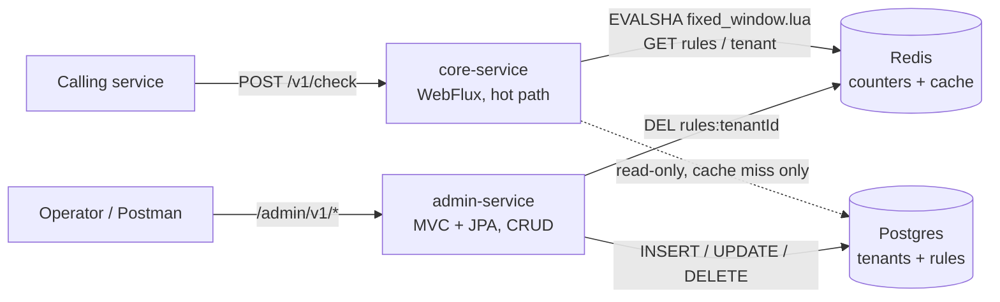
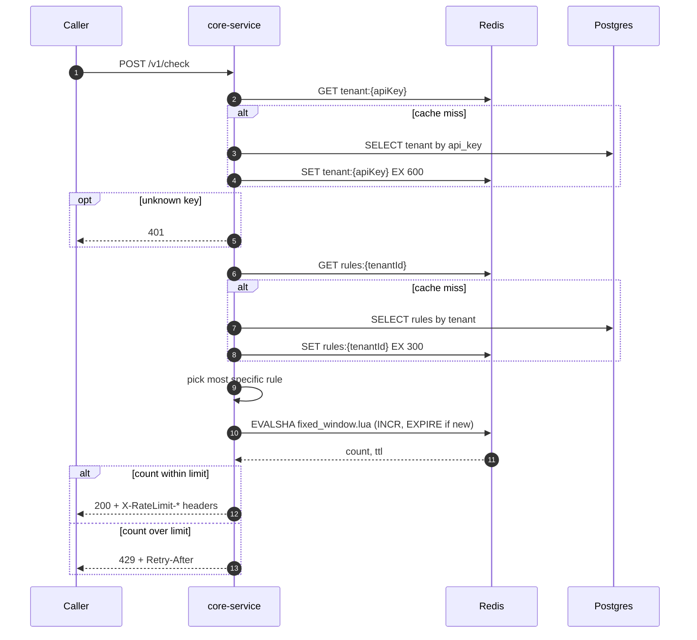
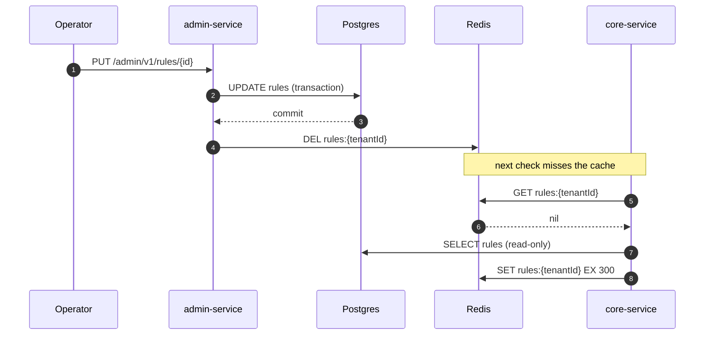
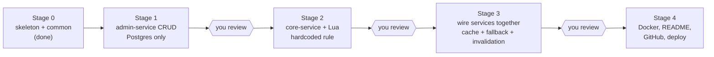

# Rate Limiter as a Service: v1 build plan

A standalone rate-limit service that other services call over HTTP. `core-service` (WebFlux) answers allow or deny in under 5ms; `admin-service` (MVC + JPA) manages tenants and rules. Fixed window and REST only. Nothing from the deferred list (token bucket, sliding window, Kafka, metrics, gRPC, k6, AI, UI) is in scope.

Stage 0 (parent POM, `common` module, both service skeletons, Maven installed) is done. Work proceeds one step at a time; tell Claude "Implement step 1.3 from PLAN.md". Claude ticks the box here when a step is finished and stops for review at the end of each stage.

## Flow diagrams

### Architecture


### One check request


### Rule edit and cache invalidation


### Build order


## Decisions (defaults, change any before the stage starts)

1. **limit column:** `LIMIT` is a reserved SQL word, so the column is `max_requests`. The DTO field stays `limit`.
2. **API key:** `rl_` plus 32 random bytes, base64url, stored as plain text in v1 because the spec looks tenants up by key.
3. **Admin auth:** none in v1, as the spec lists none. admin-service is assumed to be internal.
4. **Window start:** `floor(now / windowSeconds) * windowSeconds`, computed in core-service.
5. **Counter key:** uses the matched rule's endpoint and method, not the raw request endpoint, so a wildcard rule shares one counter. The spec says `{endpoint}`; this is a small deviation.
6. **No matching rule:** allow the request.
7. **Redis down:** fail open (allow) and log a warning.
8. **core-service Postgres access:** read-only JPA entities, called on a bounded-elastic thread so the event loop never blocks.

## Stage 1: admin-service CRUD

Tenants and rules can be created, read, updated and deleted through REST, backed by Postgres and Flyway. No Redis yet.

- [x] **1.1 Postgres in Docker Compose.** infra/docker-compose.yml with the postgres:16-bookworm image (the default Debian 13 image rejects the legacy timezone names some JVMs send, e.g. Asia/Calcutta): db ratelimiter, user and password ratelimiter, port 5432, named volume, healthcheck. Redis is added in Stage 2.
- [x] **1.2 admin-service application.yml.** Datasource from env vars with local defaults, ddl-auto=validate, Flyway on, open-in-view=false, server port 8081.
- [x] **1.3 Flyway migration V1__init.sql.** tenants(id uuid pk, name, api_key unique, created_at). rules(id uuid pk, tenant_id fk on delete cascade, endpoint, method, max_requests >0, window_seconds >0, created_at, updated_at). Unique (tenant_id, endpoint, method), which also serves lookups by tenant_id, so no separate index. The limit field maps to max_requests because LIMIT is a reserved word.
- [x] **1.4 Entities: Tenant and Rule.** JPA entities in entity/. UUIDs generated in the app, @PrePersist and @PreUpdate set the timestamps.
- [x] **1.5 Repositories.** TenantRepository with findByApiKey, RuleRepository with findByTenantId. Spring Data JPA, in repository/.
- [x] **1.6 API key generator and TenantService.** Key is rl_ plus 32 SecureRandom bytes, base64url. TenantService creates a tenant, returns TenantDto with the key, and fetches by id (404 if missing). Small mapper class, no MapStruct.
- [x] **1.7 RuleService.** Create, list by tenant, update, delete. Checks the tenant exists, rejects duplicate (tenant, endpoint, method) with a conflict error.
- [x] **1.8 CacheInvalidator stub.** An interface plus a no-op implementation called by RuleService on every write. The real Redis version arrives in step 3.9, so Stage 1 stays Postgres-only.
- [x] **1.9 TenantController.** POST /admin/v1/tenants returns 201 with the generated key. GET /admin/v1/tenants/{id}. @Valid on the body.
- [x] **1.10 RuleController.** POST /admin/v1/rules, GET /admin/v1/rules?tenantId=, PUT /admin/v1/rules/{id}, DELETE /admin/v1/rules/{id}. @Valid on bodies.
- [x] **1.11 GlobalExceptionHandler.** RateLimiterException subtypes map to 404, 409 and 400 with one JSON error shape. Bean validation errors list the failing fields.
- [x] **1.12 Postman collection.** infra/postman/rate-limiter.postman_collection.json covering all six endpoints plus the error cases. Core-service requests are added in Stages 2 and 3.
- [ ] **1.13 Unit tests.** API key format and uniqueness, mappers, and service logic with mocked repositories.
- [ ] **1.14 Controller integration tests.** @SpringBootTest with Testcontainers Postgres (needs Docker running): full CRUD, 404, 409 and 400 paths.
- [ ] **1.15 Verify Stage 1 end to end.** Bring up Postgres, run admin-service, execute the Postman flow, inspect the tables, run ./mvnw clean install. Report results and stop for review.

**Stage check:** docker compose up -d; ./mvnw clean install passes from the root; run admin-service; walk the Postman collection (create tenant, create/list/update/delete rule, 404/409/400 cases); confirm the rows in Postgres.

## Stage 2: core-service, Redis and the Lua script

POST /v1/check works against Redis with one hardcoded rule, and the Lua script is proven atomic under concurrency.

- [ ] **2.1 Add Redis to Docker Compose.** Redis 7 service with healthcheck on port 6379.
- [ ] **2.2 core-service application.yml.** Port 8080, Redis host and port from env vars. JPA and datasource auto-configuration excluded for now so it boots with Redis only.
- [ ] **2.3 RedisConfig.** ReactiveRedisTemplate<String,String> bean and a RedisScript bean that loads lua/fixed_window.lua.
- [ ] **2.4 fixed_window.lua.** KEYS[1] is the counter key, ARGV[1] the limit, ARGV[2] the window seconds. INCR, EXPIRE only when the result is 1, return the count and the remaining TTL.
- [ ] **2.5 LuaScriptExecutor.** Wraps the reactive script call (EVALSHA with fallback to EVAL on NOSCRIPT) and returns Mono<ScriptResult(count, ttl)>.
- [ ] **2.6 RateLimitAlgorithm and Decision.** The interface in algorithm/ plus the Decision record (allowed, limit, remaining, resetAt, retryAfter).
- [ ] **2.7 FixedWindowLimiter.** Computes windowStart = floor(now / windowSeconds) * windowSeconds, builds rl:{tenantId}:{rule}:{windowStart}, calls the executor, returns the Decision.
- [ ] **2.8 RateLimitService with a hardcoded rule.** Temporary 5 requests per 60 seconds, so the Redis and Lua path is proven alone. Removed in step 3.6.
- [ ] **2.9 RateLimitController.** POST /v1/check returning Mono<ResponseEntity<RateLimitResponseDto>>. 200 sets X-RateLimit-Limit, -Remaining and -Reset. 429 sets Retry-After.
- [ ] **2.10 Reactive GlobalExceptionHandler.** @RestControllerAdvice mapping validation errors to 400 and unexpected errors to 500 with the same JSON error shape as admin-service.
- [ ] **2.11 Limiter and concurrency tests.** Testcontainers Redis. Fire 200 parallel calls at limit 50 and assert exactly 50 are allowed. This is the proof that the Lua script is atomic.
- [ ] **2.12 WebTestClient tests.** Status codes, body shape and headers for the 200 and 429 responses.
- [ ] **2.13 Verify Stage 2 end to end.** Start Redis and core-service, curl the endpoint six times, check the key and TTL in redis-cli, wait for the window to roll over. Report and stop for review.

**Stage check:** curl /v1/check six times: five 200s with falling X-RateLimit-Remaining, then a 429 with Retry-After. The counter resets after the window. redis-cli shows the key with a TTL. The 200-parallel-calls test allows exactly 50 of 200.

## Stage 3: Wire the two services together

core-service reads real tenants and rules (Redis first, Postgres on a miss), admin-service invalidates the cache on writes, and the full flow works.

- [ ] **3.1 Read-only JPA in core-service.** Re-enable the datasource. @Immutable entities mapped to the existing tables, ddl-auto=none, no Flyway here (admin-service owns the schema).
- [ ] **3.2 Read repositories.** TenantReadRepository (find by api key) and RuleReadRepository (find by tenant). No save methods exposed. Calls wrapped in Mono.fromCallable on Schedulers.boundedElastic().
- [ ] **3.3 ApiKeyValidator.** GET tenant:{apiKey}. On a miss, read Postgres and SET with a 10 minute TTL. Unknown key or a tenantId that does not match the key gives 401.
- [ ] **3.4 RuleResolver cache and fallback.** GET rules:{tenantId}. On a miss, read Postgres and SET with a 5 minute TTL.
- [ ] **3.5 Most-specific rule matching.** Order: exact endpoint and method, then exact endpoint with * method, then * endpoint with exact method, then */*. Unit tests for each case. No match allows the request.
- [ ] **3.6 Wire RateLimitService.** Validate key, resolve rule, run the limiter, build the response. Remove the hardcoded rule. Counter key uses the matched rule's endpoint and method.
- [ ] **3.7 Redis failure behaviour.** If Redis errors, log a warning and fail open (allow) so a limiter outage does not take callers down. Postgres is the fallback for config reads.
- [ ] **3.8 admin-service RedisConfig.** A blocking StringRedisTemplate, used only for cache invalidation.
- [ ] **3.9 Real CacheInvalidator.** Deletes rules:{tenantId} on rule create, update and delete. Runs after the database commit (@TransactionalEventListener AFTER_COMMIT) so a stale value cannot be re-cached in between.
- [ ] **3.10 Tests.** Resolver specificity, cache miss then hit, and an invalidation test: change a rule through admin, next check uses the new limit.
- [ ] **3.11 End-to-end verification script.** A script that registers a tenant, creates a rule, hammers /v1/check, edits the rule and checks the 429 point moves. Add the core requests to the Postman collection. Report and stop for review.

**Stage check:** Register a tenant, create a rule (5 per 60s), loop /v1/check: exactly five 200s then a 429 with correct headers. Edit the rule to 10: the new limit applies immediately. Wrong key: 401. Delete the cache keys: the next call repopulates them from Postgres.

## Stage 4: Make it presentable

Anyone can clone the repo, run one command, follow the README, and reach a deployed copy.

- [ ] **4.1 admin-service Dockerfile.** Multi-stage: Maven build, then a slim JRE 21 image, non-root user.
- [ ] **4.2 core-service Dockerfile.** Same pattern as 4.1.
- [ ] **4.3 Full docker-compose.yml and .dockerignore.** Postgres, Redis, admin-service and core-service with healthchecks, depends_on service_healthy, and env wiring.
- [ ] **4.4 README.** What and why, ASCII architecture diagram, WebFlux versus MVC rationale, Redis key table, run steps, curl examples for the whole flow including a 429, project layout, deferred roadmap.
- [ ] **4.5 .gitignore and first commits.** Root .gitignore, git init, sensible initial commits. I will ask before committing.
- [ ] **4.6 Push to GitHub.** You create the repository and own it. I will ask before pushing anything.
- [ ] **4.7 Deploy to Render or Railway with Neon and Upstash.** Managed Postgres (Neon) and Redis (Upstash, TLS on). Env vars documented in the README. Free-tier cold starts noted. I will ask before any outward-facing step.

**Stage check:** docker compose up --build from a clean clone, then the README curl flow works end to end. The same flow works against the deployed URLs.

## Rules that hold throughout

- No WebFlux in admin-service. No blocking calls on the event loop in core-service.
- core-service never writes to Postgres.
- Layer-based packages exactly as in the spec tree.
- Nothing from the deferred list gets added without being asked.
- Claude stops after each stage for review.

---

# Reference (for a new chat)

## Current state (as of 2026-10-27)

- Done (Stage 0): root `pom.xml` (parent `com.ratelimiter:rate-limiter-parent`, inherits `spring-boot-starter-parent` 4.1.2, Java 21), `common` module (`RateLimitRequestDto`, `RateLimitResponseDto`, `RuleDto`, `TenantDto` records and `RateLimiterException`), `admin-service` and `core-service` generated by Spring Initializr and re-parented to the custom parent, both depend on `common`. `./mvnw -DskipTests install` passes for all four modules.
- Not started: everything in Stages 1 to 4 (all boxes above are unticked).
- Tooling: Maven 3.10.0 installed at `C:\Users\ad2ba\tools\apache-maven-3.10.0` (on user PATH; restart terminals). `./mvnw` at the project root also works. JDK 21 (Eclipse Adoptium). Windows 11, PowerShell. Docker is needed for Compose and Testcontainers.
- Generated tests (`contextLoads`) need Postgres and Redis running, so use `-DskipTests` until the services have their infra.
- Not a git repository yet (step 4.5).

## Working agreement

- One step at a time. Prompt: "Implement step X.Y from PLAN.md: <title>. Do only this step, then tell me what you changed."
- Tick the step's checkbox in this file when it is finished. Stop and report at the end of each stage.
- Do not build anything from the deferred list. Ask before committing, pushing or deploying.

## Module layout (layer-based packages, not feature-based)

```
rate-limiter-service/
├── pom.xml
├── common/            DTOs + RateLimiterException (plain jar, no Spring Boot app)
├── core-service/      WebFlux, com.ratelimiter.core
│   ├── config/RedisConfig
│   ├── controller/RateLimitController          POST /v1/check
│   ├── service/{RateLimitService, RuleResolver, ApiKeyValidator}
│   ├── algorithm/{RateLimitAlgorithm, FixedWindowLimiter}
│   ├── redis/LuaScriptExecutor
│   ├── repository/{RuleReadRepository, TenantReadRepository}   read-only
│   ├── exception/GlobalExceptionHandler
│   └── resources/{application.yml, lua/fixed_window.lua}
├── admin-service/     MVC + JPA + Flyway, com.ratelimiter.admin
│   ├── config/RedisConfig                      invalidation only
│   ├── controller/{TenantController, RuleController}
│   ├── service/{TenantService, RuleService}
│   ├── service/cache/{CacheInvalidator, NoOpCacheInvalidator}
│   ├── utils/ApiKeyGenerator
│   ├── mapper/{TenantMapper, RuleMapper}
│   ├── repository/{TenantRepository, RuleRepository}
│   ├── entity/{Tenant, Rule}
│   ├── exception/GlobalExceptionHandler
│   └── resources/{application.yml, db/migration/V1__init.sql}
└── infra/{docker-compose.yml, postman/rate-limiter.postman_collection.json}
```

## Data model

- **Tenant:** `id` (UUID pk), `name`, `apiKey` (generated, unique, indexed), `createdAt`.
- **Rule:** `id` (UUID pk), `tenantId` (fk), `endpoint` (or `*`), `method` (or `*`), `limit` (column `max_requests`), `windowSeconds`, `createdAt`, `updatedAt`.

## Redis keys

| Key | Type | TTL | Purpose |
|---|---|---|---|
| `rl:{tenantId}:{rule endpoint+method}:{windowStart}` | counter | windowSeconds | fixed-window count (see decision 5) |
| `rules:{tenantId}` | JSON | 5 min | cached rules for a tenant |
| `tenant:{apiKey}` | JSON | 10 min | cached tenant for API key validation |

Counter increments go through `fixed_window.lua` (INCR plus EXPIRE only when the count is 1).

## API contracts

**core-service** `POST /v1/check`, request `{ "tenantId": "uuid", "apiKey": "string", "endpoint": "/payments/send", "method": "POST" }`.
- 200: `{ "allowed": true, "remaining": 47, "resetAt": "2026-01-15T10:31:00Z" }` with `X-RateLimit-Limit`, `X-RateLimit-Remaining`, `X-RateLimit-Reset`.
- 429: `{ "allowed": false, "remaining": 0, "retryAfterSeconds": 12 }` with `Retry-After`.
- 401: unknown or mismatched API key.

**admin-service:** `POST /admin/v1/tenants` (returns generated key), `GET /admin/v1/tenants/{id}`, `POST /admin/v1/rules`, `GET /admin/v1/rules?tenantId=`, `PUT /admin/v1/rules/{id}`, `DELETE /admin/v1/rules/{id}`. Rule writes invalidate `rules:{tenantId}`.

## Architecture rules (from the original spec)

- The services share data stores, never APIs. core-service never calls admin-service.
- admin-service writes Postgres, then deletes the Redis key. core-service reads Redis, falls back to a read-only Postgres read on a miss, then repopulates Redis.
- WebFlux only in core-service, Spring MVC + JPA only in admin-service. Java, not Kotlin.
- v1 targets: fixed window only, REST only, under 5ms per check, deployable to Render or Railway with Neon and Upstash.
- Deferred, do not build unless asked: token bucket, sliding window log, Kafka (`rate.events` topic, analytics and audit consumers), Prometheus/Grafana/Micrometer, gRPC, k6 load tests, AI/LLM integration, admin UI.
